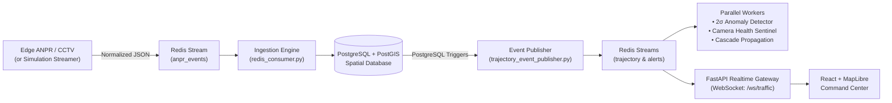

# 🚦 Visual Intelligence, Surveillance and Traffic Analytics (VISTA / NeuralGrid)

[](https://www.python.org/)
[](https://fastapi.tiangolo.com/)
[](https://react.dev/)
[](https://www.typescriptlang.org/)
[](https://postgis.net/)
[](https://redis.io/)
[](LICENSE)

A distributed, city-scale intelligent transportation and surveillance platform designed to transform real-time ANPR (Automatic Number Plate Recognition) camera observations into high-level urban traffic intelligence. 

The platform supports automated cross-camera trajectory reconstruction, dynamic congestion analysis, cascade delay propagation modeling, statistical route anomaly detection, real-time vehicle watchlist surveillance, and automated incident dispatch over interactive GIS command center dashboards.

> 📖 **Looking for in-depth technical documentation?**  
> Check out the [Technical Design Document](TECHNICAL_DESIGN.md) for sequence diagrams, ER models, and mathematical formulations, or the [System Architecture & Feature Guide](SYSTEM_ARCHITECTURE_AND_FEATURES.md) for UI walkthroughs.

---

## 🏛️ System Architecture

VISTA decouples the edge perception layer from analytical engines through an event-driven stream bus:



### Core Pipeline
1. **Edge Perception**: Edge CCTV and AI pipelines detect vehicles, extract license plates, and push normalized events to Redis (`anpr_events`).
2. **Ingestion & Registration**: Background consumers auto-register vehicles and persist timestamped spatial coordinates (`Point, 4326`) into PostgreSQL.
3. **Trajectory Reconstruction**: Associates sequential sightings of the same vehicle across camera pairs, computes travel duration and speed, and maps geometry along OpenStreetMap road networks.
4. **Watchlist Surveillance**: Incoming observations are matched in real-time against `vehicle_watchlist` records, instantly generating `WATCHLIST_HIT` alerts.
5. **Real-Time Dissemination**: Database triggers fire `pg_notify` to publish new trajectories and incidents to Redis, which forwards them over WebSockets (`/ws/traffic`).
6. **Continuous Analytics**: Background workers calculate moving baseline travel times, detect statistical anomalies ($2\sigma$), predict downstream delay cascades, and monitor camera uptime.
7. **Command Dashboard**: A responsive, dark-mode GIS command center with live MapLibre surveillance, vehicle dossiers, and diurnal traffic curves.

---

## 🚀 Key Implemented Features

### 1. GIS & Trajectory Reconstruction Engine
* **Automated Journey Stitching**: Sequences multiple independent camera detections into continuous journey segments.
* **Road Topology Matching**: Uses OpenStreetMap (OSM) graph definitions to map camera-to-camera journeys onto physical roads.
* **Observation Gap Detection**: Identifies unmonitored camera gaps along a route without interpolating misleading fake paths.
* **Origin-Destination (OD) Matrix**: Aggregates vehicle journeys into city-wide commuter flow matrices.

### 2. Congestion & Cascade Delay Propagation Analytics
* **Historical Baseline Comparison**: Evaluates 15-minute tumbling windows to calculate real-time delay percentages relative to historical free-flow speeds (`same_time_yesterday`, `same_time_last_week`, `previous_period`).
* **Multi-Factor Propagation Modeling**: Projects downstream delay cascades using a 4-component weighted model: source delay, turning probability, corridor continuation capacity, and downstream bottleneck severity.

### 3. Anomaly & Incident Detection
* **Statistical Route Anomaly Detection**: Dynamic sample-based statistical bounds ($\mu \pm 2\sigma$) flag abnormal travel delays, unauthorized stops, or route deviations.
* **Collective Movement Detection**: Flags multi-vehicle convoy or surge anomalies when 3+ vehicles travel in tight temporal formations.
* **Camera Health & Network Sentinel**: Calculates time-to-last-event intervals for every camera, classifying nodes as `HEALTHY`, `WARNING`, or `OFFLINE`.
* **Spatial Authority Assignation**: Uses PostGIS spatial containment (`ST_Within`) to automatically assign incidents to responsible traffic police divisions.
* **Vehicle Watchlist Surveillance**: Intercepts hotlisted vehicles with priority classifications and RBAC plate masking for privacy compliance.

### 4. Scenario-Driven Live Simulation Streamer
* **Autonomous 25-Minute Simulation**: Simulates realistic city traffic across 5 corridors, looping continuously for presentations.
* **6 Scripted Demonstration Scenarios**:
  - *Scenario 1: Baseline City Flow* (All cameras healthy green, live trajectory stitching).
  - *Scenario 2: Watchlist Intrusion* (Critical stolen vehicle alert flashing on map).
  - *Scenario 3: Route Travel-Time Anomaly* (Breakdown/detour flagged by $2\sigma$ detector).
  - *Scenario 4: Camera Heartbeat Drop & Recovery* (Camera status transitions Healthy $\to$ Warning $\to$ Offline and auto-recovery).
  - *Scenario 5: Congestion Surge & Delay Cascade* (Traffic jam with downstream spillover).
  - *Scenario 6: Coordinated Convoy Detection* (3+ vehicles traveling closely in convoy).
* **Speed Multipliers**: Run at real-time (`--speed 1`), 2x (`--speed 2`), or 3x (`--speed 3`) speed.
* **Interactive Hotkeys**: Manually trigger any scenario during a live demonstration.

---

## 📂 Repository Structure

```text
.
├── .env.example                        # Template for environment configuration
├── .gitignore                          # Git ignore rules for clean repository
├── LICENSE                             # MIT License file
├── README.md                           # Main system guide and setup documentation
├── TECHNICAL_DESIGN.md                 # Detailed technical design document with architecture diagrams
├── SYSTEM_ARCHITECTURE_AND_FEATURES.md # In-depth feature breakdown & frontend guide
├── requirements.txt                    # Python dependencies
├── schema.sql                          # PostgreSQL PostGIS schema DDL & triggers
├── setup_advanced_schema.py            # Watchlist, audit logs & performance index initialization
├── seed_historical_intelligence.py     # 14-day historical baseline traffic generator
├── start_system.py                     # Multi-process orchestrator for all backend services
│
├── app/                                # FastAPI Backend Application
│   ├── advanced_routes.py              # Telemetry, watchlist, vehicle search, baselines, exports
│   ├── audit_service.py                # Security audit logging & RBAC plate masking
│   ├── database.py                     # PostgreSQL connection pool & Redis client factories
│   ├── main.py                         # REST API endpoints & route controllers
│   ├── realtime.py                     # WebSocket ConnectionManager & Redis stream consumer
│   ├── schemas.py                      # Pydantic data schemas & response models
│   └── time_utils.py                   # Defensive ISO-8601 parsing & historical baseline windows
│
├── frontend-1/                         # React + TypeScript + Tailwind + MapLibre Command Center
│   ├── index.html                      # Single-page application entrypoint
│   ├── package.json                    # Frontend dependencies & scripts
│   ├── vite.config.ts                  # Vite configuration & path aliases
│   └── src/
│       ├── App.tsx                     # Main application layout & view switcher
│       ├── components/                 # UI components, MapLibre canvas, Floating Q&A Assistant
│       ├── context/                    # AppData, Selection, TimeRange, and Map contexts
│       └── pages/                      # 7 Dedicated Command Center Pages:
│           ├── CommandCenter.tsx       # Live GIS surveillance map, corridors, active incidents
│           ├── TrafficAnalytics.tsx    # Diurnal flow curves, congestion trends, zone density
│           ├── VehicleInvestigation.tsx# Dossier search, trajectory playback, observation gaps
│           ├── RouteOD.tsx             # Historical comparison widget & OD trip matrix
│           ├── Alerts.tsx              # Incident command center with division filtering
│           ├── SystemHealth.tsx        # PostgreSQL/Redis telemetry & camera freshness audit
│           └── Settings.tsx            # System thresholds & map configurations
│
├── tests/                              # Automated Unit & Integration Test Suite
│   ├── test_time_utils.py              # Defensive timestamp & baseline window test cases
│   └── test_advanced_endpoints.py      # End-to-end API, RBAC masking, watchlist tests
│
├── check/                              # GIS Road Network & Topology Utilities
│   ├── all_camera_routes_osm.geojson   # Exported GeoJSON route paths
│   ├── check_all_camera_routes.py      # Camera-to-camera connectivity checker
│   └── generate_camera_routes.py       # Shortest path calculation between camera pairs
│
├── demo_streamer.py                    # Autonomous 25-min scenario-driven ANPR simulation engine
├── event_ingestion.py                  # Ingests normalized ANPR JSON into PostgreSQL
├── redis_producer.py                   # Utility to publish events to Redis stream
├── redis_consumer.py                   # Worker: ingests ANPR events, stitches journeys, flags watchlist
├── trajectory_engine.py                # Reconstructs trajectories from consecutive events
├── trajectory_event_publisher.py       # Publishes DB trajectory & alert notifications to Redis
├── route_anomaly_worker.py             # Background anomaly detector (2σ travel-time deviations)
├── camera_health_worker.py             # Background camera uptime and latency monitor
├── collective_movement_engine.py       # Evaluates group movement surge anomalies
├── congestion_engine.py                # Aggregates historical congestion in 15-minute windows
├── congestion_propagation_engine.py    # Predicts cascade delays across connected road links
└── authority_assignment_engine.py      # Assigns alerts to city zones and traffic authorities
```

---

## 🛠️ Setup & Startup Guide

### Prerequisites
* **Python**: 3.11 or higher
* **Node.js**: 18.x or higher with `npm`
* **PostgreSQL**: 15+ with the **PostGIS** extension installed
* **Redis**: 7.0+ (Local Redis or Redis Cloud)

---

### Step 1: Environment Configuration

1. Copy the example environment template:
   ```bash
   cp .env.example .env
   ```
2. Open `.env` and configure your credentials:
   ```env
   # PostgreSQL + PostGIS Database Configuration
   DB_HOST=localhost
   DB_PORT=5432
   DB_NAME=city_traffic
   DB_USER=postgres
   DB_PASSWORD=your_postgres_password
   DB_SSLMODE=disable

   # Redis Configuration (Streams & Pub/Sub)
   REDIS_HOST=localhost
   REDIS_PORT=6379
   REDIS_USERNAME=default
   REDIS_PASSWORD=
   REDIS_SSL=false
   ```

#### Environment Variables Reference
| Variable | Default | Description |
| :--- | :--- | :--- |
| `DB_HOST` | `localhost` | Hostname or IP address of the PostgreSQL database. |
| `DB_PORT` | `5432` | Port on which PostgreSQL is listening. |
| `DB_NAME` | `city_traffic` | Database name containing tables and PostGIS extension. |
| `DB_USER` | `postgres` | PostgreSQL username. |
| `DB_PASSWORD` | *(none)* | PostgreSQL user password. |
| `DB_SSLMODE` | `disable` | SSL mode (`disable` for local, `require` for cloud like Supabase/RDS). |
| `REDIS_HOST` | `localhost` | Hostname or IP address of the Redis instance. |
| `REDIS_PORT` | `6379` | Port for Redis connection. |
| `REDIS_USERNAME`| `default` | Username for Redis ACL authentication. |
| `REDIS_PASSWORD`| *(none)* | Password for Redis authentication (leave blank for local without auth). |
| `REDIS_SSL` | `false` | Set to `true` when connecting to TLS-secured Redis Cloud instances. |

---

### Step 2: Python Virtual Environment & Dependencies

```bash
# Create and activate virtual environment
python -m venv venv

# On Windows (PowerShell):
.\venv\Scripts\Activate.ps1

# On Linux / macOS:
source venv/bin/activate

# Install dependencies
pip install -r requirements.txt
```

---

### Step 3: Database Initialization

1. Ensure the PostgreSQL service is running and create the database:
   ```sql
   CREATE DATABASE city_traffic;
   ```
2. Execute the base schema (installs PostGIS, creates tables, indexes, triggers, and camera seeds):
   ```bash
   psql -h localhost -U postgres -d city_traffic -f schema.sql
   ```
3. Run the advanced schema migration (creates watchlist, audit logs, and performance indexes):
   ```bash
   python setup_advanced_schema.py
   ```

---

### Step 4: Seed Historical Baseline Intelligence

Populate 14 days of realistic historical traffic baseline data dynamically anchored to `CURRENT_TIMESTAMP`:
```bash
python seed_historical_intelligence.py
```
This generates:
* **11,000+** spatial ANPR observation events across Chennai.
* **17,000+** multi-camera trajectory hops matching OpenStreetMap paths.
* **5,000+** completed origin-destination trips powering the OD matrix.
* **4,300+** 15-minute tumbling historical congestion windows.
* Active watchlist targets and multi-division police alerts.

---

### Step 5: Launch Backend Services & Live Simulation

Start all 6 backend services plus the autonomous simulation streamer in a single command:
```bash
python start_system.py --demo
```

This launches:
* **FastAPI Gateway**: `http://127.0.0.1:8000` (Interactive API docs at `/docs`)
* **Redis Consumer**: Ingests observations, auto-reconstructs trajectories, checks watchlist
* **Trajectory Publisher**: Forwards newly created journeys & alerts to Redis
* **Route Anomaly Worker**: Flags statistical travel-time outliers ($Mean \pm 2\sigma$)
* **Camera Health Sentinel**: Continuously audits camera heartbeats
* **Analytics Worker**: Recomputes historical congestion & propagation metrics
* **Live Simulation Streamer**: Continuously generates real-time ANPR traffic with scripted scenarios

> To start the services without the simulated streamer (e.g. when connecting real camera streams), omit the `--demo` flag:
> ```bash
> python start_system.py
> ```

---

### Step 6: Launch Command Center Frontend

Open a second terminal window:
```bash
cd frontend-1
npm install
npm run dev
```

Open your browser to **`http://localhost:5173`**.

---

## 🎮 Interactive Live Demo Controls

While `demo_streamer.py` (or `python start_system.py --demo`) is running, you can press any of the following keys in its console window and press **Enter** to trigger real-time scenarios on demand:

| Hotkey | Scenario Triggered | Observed Dashboard Behavior |
| :---: | :--- | :--- |
| <kbd>w</kbd> + Enter | **Critical Watchlist Hit** | Sights stolen luxury SUV `TN09BV1907` at CAM01 $\to$ CAM02. Instantly flashes a **High-Priority Red Alert Banner** on the map & logs incident card. |
| <kbd>a</kbd> + Enter | **Route Travel-Time Anomaly** | Sights vehicle `TN07CD4567` with an extreme travel delay ($+3.2\sigma$ above mean). Flags a **`ROUTE_ANOMALY`** alert assigned to Guindy Division. |
| <kbd>c</kbd> + Enter | **Camera Dropout / Recovery** | Toggles CAM04 (Taramani Tech Park). First press drops the feed (**Green $\to$ Yellow $\to$ Red Offline**); second press restores it back to **Healthy (Green)**. |
| <kbd>j</kbd> + Enter | **Congestion Jam Surge** | Injects 8 vehicles in rapid succession along Anna Salai corridor, spiking delay percentage and triggering cascade delay propagation. |
| <kbd>k</kbd> + Enter | **Coordinated Convoy** | Injects 3 vehicles (`TN02XY1111`, `2222`, `3333`) traveling in tight 3-second spacing, triggering a **`COLLECTIVE_MOVEMENT`** alert. |
| <kbd>h</kbd> + Enter | **Help Menu** | Displays all available keyboard hotkeys. |
| <kbd>q</kbd> + Enter | **Quit** | Cleanly shuts down the streamer. |

---

## 🧪 Automated Tests & Build Verification

### Backend Test Suite
Run the unit and integration tests:
```bash
python -m unittest discover -s tests -p "test_*.py"
```

### Frontend Production Build
Verify TypeScript type safety and compile production assets:
```bash
cd frontend-1
npm run typecheck
npm run build
```

---

## 📄 License

This project is licensed under the terms of the [MIT License](LICENSE).
