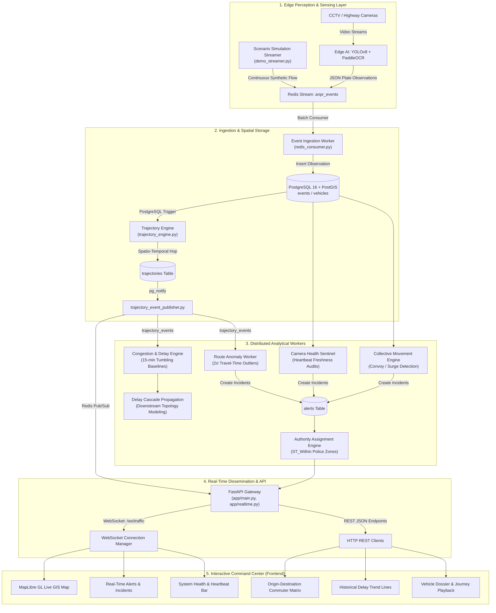
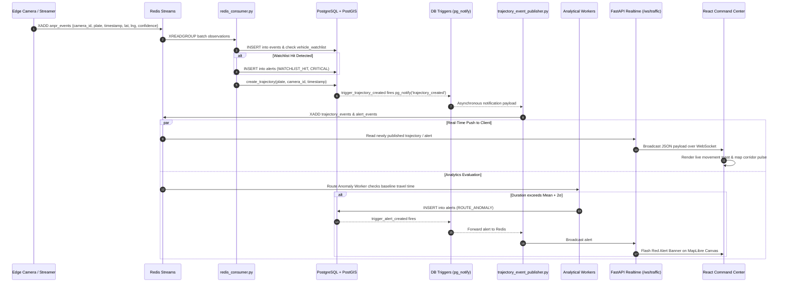
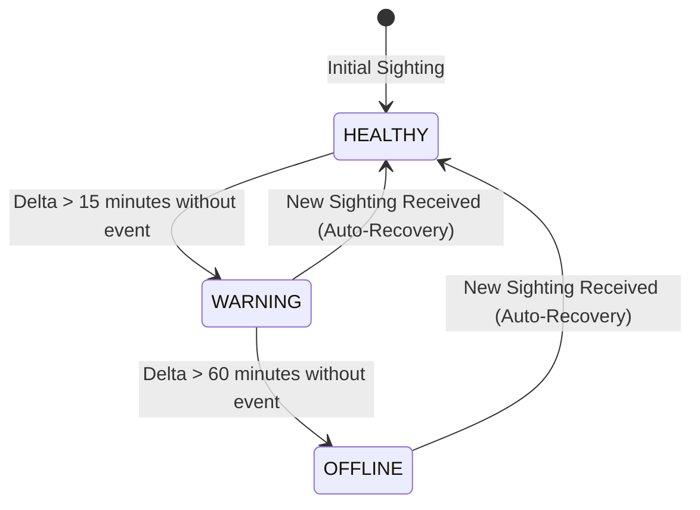

# 📐 Technical Design Document
## Visual Intelligence, Surveillance and Traffic Analytics (VISTA / NeuralGrid)

---

## 1. Executive Summary & Architectural Objectives

The **Visual Intelligence, Surveillance and Traffic Analytics (VISTA)** platform is a distributed, event-driven intelligent transportation system (ITS). Designed for smart cities, it ingests high-frequency Automatic Number Plate Recognition (ANPR) and computer vision camera observations across urban arterial corridors, transforming raw spatiotemporal detections into actionable urban mobility intelligence.

### Key Capabilities
* **Sub-Second Event Ingestion**: High-throughput message queuing using Redis Streams.
* **Continuous Trajectory Stitching**: Dynamic reconstruction of vehicle trajectories matching OpenStreetMap (OSM) road topologies without interpolating synthetic hops.
* **Predictive Congestion & Cascade Delay Modeling**: Multi-factor propagation models estimating downstream delay spillover across connected links.
* **Statistical Route Anomaly Detection**: Real-time identification of abnormal travel durations using dynamic sample bounds ($Mean \pm 2\sigma$).
* **Watchlist & Hotlist Surveillance**: Instant alerting on high-priority targets with Role-Based Access Control (RBAC) plate masking for privacy compliance.
* **Camera Health Sentinel**: Automated heartbeat monitoring classifying network sensors into `HEALTHY`, `WARNING`, and `OFFLINE` states.
* **Geospatial Command Center**: A modern single-page dashboard powered by React 18, TypeScript, Tailwind CSS, Recharts, and MapLibre GL.

---

## 2. High-Level System Architecture



---

## 3. End-to-End Event Lifecycle & Sequence

The following sequence details how an ANPR camera observation travels from edge detection to live command center rendering:



---

## 4. Database Schema & Entity-Relationship Model

```mermaid
erDiagram
    cameras ||--o{ events : "records"
    cameras ||--o{ camera_routes : "starts/ends"
    cameras ||--o{ alerts : "generates"
    vehicles ||--o{ events : "identified in"
    vehicles ||--o{ trajectories : "performs"
    vehicles ||--o{ trips : "completes"
    zones ||--o{ alerts : "jurisdiction"
    vehicle_watchlist ||--o{ alerts : "flags"

    cameras {
        varchar camera_id PK "e.g. CAM01"
        varchar name "e.g. Kathipara Junction ANPR"
        varchar status "ACTIVE, MAINTENANCE, OFFLINE"
        geometry location "Point, SRID 4326"
        timestamptz created_at
        timestamptz updated_at
    }

    vehicles {
        serial vehicle_id PK
        varchar plate_number UK "e.g. TN09BV1907"
        timestamptz created_at
        timestamptz updated_at
    }

    events {
        serial event_id PK
        integer vehicle_id FK
        varchar camera_id FK
        varchar plate_number
        varchar vehicle_type "Car, SUV, Bus, Truck"
        varchar make
        varchar model
        varchar color
        timestamptz observed_at
        numeric confidence
        numeric heading
        geometry location "Point, SRID 4326"
        jsonb raw_data
    }

    trajectories {
        serial trajectory_id PK
        integer vehicle_id FK
        varchar from_camera_id FK
        varchar to_camera_id FK
        timestamptz started_at
        timestamptz ended_at
        numeric travel_time_seconds
        numeric distance_m
        geometry geometry "LineString / MultiLineString"
        varchar inference_method "DIRECT, MULTI_HOP"
    }

    camera_routes {
        serial route_id PK
        varchar starting_node FK
        varchar ending_node FK
        numeric total_distance_m
        geometry geometry "MultiLineString, SRID 4326"
    }

    alerts {
        serial alert_id PK
        varchar alert_type "WATCHLIST_HIT, ROUTE_ANOMALY, CAMERA_HEALTH, COLLECTIVE_MOVEMENT"
        varchar severity "CRITICAL, HIGH, MEDIUM, LOW"
        text message
        varchar camera_id FK
        integer zone_id FK
        varchar authority_name "e.g. Guindy Division"
        timestamptz detected_at
        varchar status "ACTIVE, ACKNOWLEDGED, RESOLVED"
        jsonb metadata
    }

    historical_congestion {
        serial congestion_id PK
        varchar from_camera_id FK
        varchar to_camera_id FK
        timestamptz time_window_start
        timestamptz time_window_end
        integer vehicle_count
        numeric baseline_travel_time_seconds
        numeric average_travel_time_seconds
        numeric average_delay_percent
        varchar congestion_level "LOW, MODERATE, HIGH, SEVERE"
    }

    vehicle_watchlist {
        serial watchlist_id PK
        varchar plate_number UK
        varchar status "active, inactive"
        text reason
        varchar case_reference
        varchar priority "CRITICAL, HIGH, MEDIUM"
        varchar created_by
    }

    zones {
        serial zone_id PK
        varchar zone_name
        varchar authority_name
        geometry boundary "Polygon / MultiPolygon, SRID 4326"
    }
```



---

## 5. Analytical Models & Mathematical Formulations

### 5.1 Dynamic Statistical Route Anomaly Detection
To prevent false alarms arising from rigid static thresholds, link traversal durations are evaluated against rolling empirical distributions for each camera pair:

$$\mu = \frac{1}{N} \sum_{i=1}^{N} t_i, \quad \sigma = \sqrt{\frac{1}{N-1} \sum_{i=1}^{N} (t_i - \mu)^2}$$

An alert is raised when the observed traversal duration $t_{\text{obs}}$ satisfies:

$$z = \frac{t_{\text{obs}} - \mu}{\sigma} \ge 2.0 \quad \text{or} \quad z \le -2.0$$

* $+z \ge 2.0$: Indicates anomalous delay, unexpected stopping, accident, or detour.
* $-z \le -2.0$: Indicates extreme speeding violations between checkposts.

### 5.2 Multi-Factor Cascade Delay Propagation Model
Congestion on upstream road link $L_u$ propagates to downstream link $L_d$ according to:

$$\Delta t_{\text{cascade}}(L_d) = w_1 \cdot D(L_u) + w_2 \cdot P(L_u \to L_d) + w_3 \cdot C(L_d) + w_4 \cdot B(L_d)$$

Where:
* $D(L_u)$: Delay severity on source link ($\frac{t_{\text{current}} - t_{\text{baseline}}}{t_{\text{baseline}}}$).
* $P(L_u \to L_d)$: Turning probability from historical Origin-Destination routing matrices.
* $C(L_d)$: Downstream corridor continuation capacity factor.
* $B(L_d)$: Downstream bottleneck index (active incidents or capacity restrictions).
* Weights default to: $w_1 = 0.40, w_2 = 0.25, w_3 = 0.20, w_4 = 0.15$.

### 5.3 Camera Health State Machine



---

## 6. Real-Time Streaming & WebSocket Protocol

### Connection Endpoint
`GET /ws/traffic` (Upgraded to WebSocket)

### Wire Formats

#### 1. Trajectory Created Event
```json
{
  "event_type": "TRAJECTORY_CREATED",
  "trajectory_id": 14092,
  "vehicle_id": "TN09BV1907",
  "from_camera_id": "CAM01",
  "to_camera_id": "CAM02",
  "travel_time_seconds": 184.2,
  "distance_m": 2450.0,
  "speed_kmh": 47.88,
  "started_at": "2026-11-03T12:00:00Z",
  "ended_at": "2026-11-03T12:03:04Z"
}
```

#### 2. Incident Alert Event
```json
{
  "event_type": "ALERT_CREATED",
  "alert_id": 892,
  "alert_type": "WATCHLIST_HIT",
  "severity": "CRITICAL",
  "message": "Flagged vehicle TN09BV1907 sighted at CAM01 (Kathipara Junction)",
  "camera_id": "CAM01",
  "camera_name": "Kathipara Junction ANPR",
  "authority_name": "Guindy Division",
  "detected_at": "2026-11-03T12:03:04Z",
  "status": "ACTIVE"
}
```

#### 3. Camera Health Updated Event
```json
{
  "event_type": "CAMERA_HEALTH_UPDATED",
  "camera_id": "CAM04",
  "camera_name": "Taramani Tech Park ANPR",
  "health_status": "OFFLINE",
  "minutes_since_last_event": 64.2,
  "timestamp": "2026-11-03T12:05:00Z"
}
```

---

## 7. Security, Privacy & RBAC Masking

1. **Role-Based License Plate Masking**:
   * Regulatory compliance standardizes plate masking for general dashboard operators (`TN09****07`).
   * Authorized supervisory roles (`ROLE_INVESTIGATOR`, `ROLE_ADMIN`) receive unmasked plates via authenticated session tokens.
2. **Audit Trail Logging**:
   * Every query to the vehicle dossier, watchlist modifications, and alert status transitions are recorded into `audit_logs` with username, client IP, action type, and timestamp.
3. **Defensive ISO-8601 Timestamp Handling**:
   * `app/time_utils.py` defensively normalizes offset-naive, offset-aware, and millisecond-variant timestamps into uniform UTC timestamps.

---

## 8. Deployment & Process Topology

```text
[ start_system.py ] (Process Supervisor)
 ├── [1] FastAPI Uvicorn Server       (Port 8000: REST & WebSocket)
 ├── [2] Redis Consumer Worker         (Batch Ingestion & Trajectory Stitching)
 ├── [3] Trajectory Event Publisher    (PostgreSQL NOTIFY -> Redis Streams)
 ├── [4] Route Anomaly Worker          (2σ Outlier Detector)
 ├── [5] Camera Health Sentinel        (Heartbeat Freshness Auditor)
 ├── [6] Analytics Worker              (15-min Congestion Baselines & Cascades)
 └── [7] Live Simulation Streamer      (Autonomous 25-Min Scenario Loop)
```

